<div align="center">


<a href="https://github.com/connectwithdevarsh">
  
</a>

<br/>


 


 


<br/><br/>



</div>

<div align="center"></div>

## 🤖 whoami

```js
const devarsh = {
  alias: "connectwithdevarsh",
  role: ["IT Student", "Full-Stack Developer", "Flutter Developer", "AI Builder"],
  institute: "RC Technical Institute, Ahmedabad (GTU)",
  program: "Diploma in Information Technology | Semester 5",
  location: "Ahmedabad, India",
  internship: "INFOLABZ IT Services Pvt. Ltd.",
  focus: ["Backend & APIs", "Flutter", "AI / LLM", "IoT (ESP32)"],
  motto: "Problem first. Technology second. Build, test, improve, ship.",
  openTo: ["Technical internships", "Software projects", "Collaborations"]
};
```

<div align="center"></div>

## ⚡ Tech Loadout

<div align="center">


</div>

<div align="center"></div>

## 🛠️ Mission Archive: Projects

| Suit | What's inside | Stack |
|:--|:--|:--|
| 🌐 [**EKAA PG**](https://github.com/connectwithdevarsh/REPO_NAME) | PG management: tenants, bed allocation, monthly accounting, dues, complaints, notices | React · Vite · Express · Firebase |
| 🌐 [**EduNotesPro**](https://github.com/connectwithdevarsh/REPO_NAME) | Notes platform: auth, syllabus organization, reviews | Flask · SQLite · Vercel |
| 📱 [**AIPE Lab**](https://github.com/connectwithdevarsh/REPO_NAME) | Flutter companion app for AI & Prompt Engineering practicals | Flutter · Dart · Provider |
| 📱 [**Shilp Shastra**](https://github.com/connectwithdevarsh/REPO_NAME) | Offline bilingual Gujarati/English measurement app | Flutter · Dart · Offline Storage |
| 🤖 [**EduForecast**](https://github.com/connectwithdevarsh/REPO_NAME) | Academic risk prediction, built in INFOLABZ internship | Python · Pandas · Scikit-Learn |
| 🔌 [**ESP32 Gas Safety**](https://github.com/connectwithdevarsh/REPO_NAME) | Gas sensors, relay ventilation, Telegram emergency alerts | ESP32 · C++ · Telegram Bot API |
| 🤖 [**DevAI Assistant**](https://github.com/connectwithdevarsh/REPO_NAME) | AI developer utility: code explanations, workflow help | AI / LLM |

<div align="center"></div>

## 🎯 Mission Log

- [x] Build full-stack platforms (EKAA PG, EduNotesPro)
- [x] Ship Flutter apps (AIPE Lab, Shilp Shastra)
- [x] Complete technical internship training at INFOLABZ
- [x] Build a software-hardware system (ESP32 Gas Safety)
- [ ] Master backend architecture, REST APIs and database design
- [ ] Learn CI/CD, testing and deployment
- [ ] Land a technical internship

<div align="center"></div>

## 📊 Arc Reactor Stats

<div align="center">


<br/><br/>


</div>

<div align="center"><img src="https://raw.githubusercontent.com/connectwithdevarsh/connectwithdevarsh/main/divider.svg" width="100%" alt=""/
